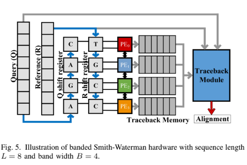
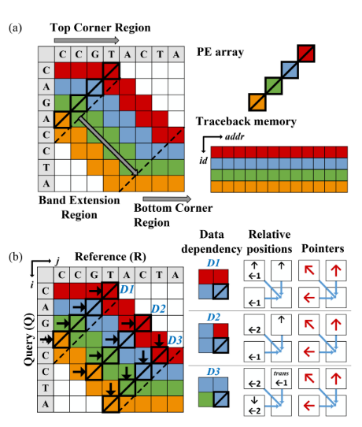

# Banded Smith Waterman Genome Alignment
Software (Python golden model) and hardware (Verilog RTL) implementation of the
**banded** Smith-Waterman algorithm with affine gap penalty and **hardware traceback**.

**Design report (algorithm, circuit diagrams, verification results): [report/REPORT.md](report/REPORT.md)**

## What is BSW
It resembles the SW algorithm, but only a band around the main diagonal of the DP table is computed,
which reduces both computation and traceback memory.

The architecture follows
> Liao et al., *Adaptively Banded Smith-Waterman Algorithm for Long Reads and Its Hardware Accelerator*, ASAP 2018
> (https://ieeexplore.ieee.org/document/8445105)

### Band definition (from the paper)
* `B` PEs sit on an anti-diagonal of the L×L DP matrix. In step `t` the front is at `(r, c)` and
  PE `k` computes cell `(i, j) = (r + k, c - k)`, so all cells of one step are independent.
* The front moves one cell per step:
  * `B-1` right shifts (top corner, PEs become active one by one)
  * `2(L-B)` alternating down / right shifts (down first)
  * `B-1` right shifts (bottom corner, ends at cell `(L-1, L-1)`)

  ```
  r(t) = 0                               t <= B-1
       = min(ceil((t-B+1)/2), L-B)       otherwise          c(t) = t - r(t),   t = 0 .. 2L-2
  ```
* This visits every cell with **`-B <= j - i <= B-1`** exactly once (2B diagonals, B cells per anti-diagonal).
  Cells outside the band are treated as `H = 0, E = F = -inf`.
* A right shift moves only the T shift register, a down shift only the S shift register.




## Scope: a single-tile accelerator
This design aligns **one tile**: a query `S` and a reference `T` of exactly the same length `L` (a compile-time
parameter, default 256), computing only the band `-B <= j-i <= B-1` of that tile. `L` *is* the tile size and `B` the
band width, so both can be chosen for the application. Memory and area scale as follows:

* traceback memory = (2L - 1) x 4B bit, i.e. **linear in L and in B** (a full SW tile would need 4·L² bit);
* PEs = `B`; score width = ⌈log2(8L+1)⌉ + 1 bit.

| `L` (tile size) | score width | B = 4 | B = 16 | full SW tile (4·L²) for comparison |
|---:|---:|---:|---:|---:|
| 64 | 11 bit | 2,032 bit | 8,128 bit | 16,384 bit |
| 128 | 12 bit | 4,080 bit | 16,320 bit | 65,536 bit |
| 256 | 13 bit | 8,176 bit | 32,704 bit | 262,144 bit |
| 512 | 14 bit | 16,368 bit | 65,472 bit | 1,048,576 bit |
| 1024 | 15 bit | 32,752 bit | 131,008 bit | 4,194,304 bit |
| 2048 | 16 bit | 65,520 bit | 262,080 bit | 16,777,216 bit |

Only `L` = 4 … 256 has been simulated; larger values follow from the same parameterization but are not verified.

In real workloads `S` and `T` are usually similar, so the alignment is concentrated around the main diagonal. That is
what the band exploits, and it is also why long sequences are meant to be cut into tiles along the diagonal with the
per-tile results chained together. **This repository only implements the single tile.** Chaining the tiles is *not*
handled: passing the boundary state (H / E / F) between neighbouring tiles, merging the best scores and concatenating
the traceback paths have to be done outside this module. Inputs must have exactly `L` bases (gaps between `valid`
cycles are allowed); shorter sequences have to be padded and different lengths are not supported.

## Scoring
match +8, mismatch -5, gap open -7, gap extend -3 (same as the SW repository)
```
E(i,j) = max(E(i,j-1) - 3, H(i,j-1) - 7)          gap in S  (INS)
F(i,j) = max(F(i-1,j) - 3, H(i-1,j) - 7)          gap in T  (DEL)
H(i,j) = max(0, H(i-1,j-1) + s(S[i],T[j]), E(i,j), F(i,j))
```
Tie-break rules (identical in Python and RTL): best cell = highest score, then smallest `i`, then smallest `j`;
H source DIAG > UP (F) > LEFT (E), stop at `H == 0`; a gap is extended only if strictly better than opening.

## Software
* `BSW.py` – golden model (scoring + traceback), bit-exact with the RTL.
  `python3 BSW.py [--band B] [--s a.dat --t b.dat]` (`--band 0` = full SW)
* `gen_pattern.py` – generates `testbench/pattern/caseNNN_{s,t,golden}.dat` and `cases.txt`
  (`--band B`, `--length L`, `--random N`, `--pairs s.dat t.dat`)

## Hardware (`verilog/BSW.v`)
| parameter | meaning |
|---|---|
| `L` | sequence length of S and T (default 256) |
| `B` | number of PEs = band parameter (default 4, any `1 <= B <= L`) |

### PE dependencies
The neighbours of PE `k` depend on the last two moves of the front:

| needed cell | after a right move | after a down move |
|---|---|---|
| up `(i-1, j)` : H, F | PE `k-1` @ t-1 | PE `k` @ t-1 |
| left `(i, j-1)` : H, E | PE `k` @ t-1 | PE `k+1` @ t-1 |

diag `(i-1, j-1)` : H of PE `k-1` @ t-2 if the last two moves were right, right (corners), otherwise PE `k` @ t-2.
A neighbour index outside `0..B-1` or an inactive PE means the cell is outside the band / matrix.

Only the H/E/F of the last step and H of the step before are kept (two register stages per PE).

### Traceback
* In step `t` the B PEs write one word of B 4-bit pointers `{hsrc[1:0], e_ext, f_ext}` to address `t`
  of the traceback memory (`2L-1` words × `4B` bits – only the band is stored).
* Cell `(i, j)` is found at address `t = i + j`, PE `k = i - r(t)`; `e_ext / f_ext` make affine gaps traceable.
* The traceback FSM starts at the best cell and emits one op per cycle until `H = 0`.

### Interface
| port | dir | description |
|---|---|---|
| `valid`, `data_s[1:0]`, `data_t[1:0]` | in | `S[k]`, `T[k]` for k = 0..L-1, one pair per `valid` cycle (idle cycles in between are allowed) |
| `aln_valid`, `aln_op[1:0]` | out | ops from the alignment **end back to its start**: 0 MATCH, 1 MISMATCH, 2 INS (gap in S), 3 DEL (gap in T) |
| `finish` | out | 1-cycle pulse when traceback is done |
| `max` | out | best score |
| `end_i`, `end_j` / `start_i`, `start_j` | out | indices of the last / first aligned pair |
| `aln_len` | out | number of ops |

Latency after the last input: `2L + 3 + #ops` cycles (load → 1 init cycle → 2L-1 steps → traceback).
The design returns to idle after `finish` and accepts the next pair without reset.

### Simulation
```
cd testbench
source license.sh
vcs tb_BSW.v +define+RTL -full64 -R -debug_access+all +v2k +notimingcheck        # B = 4
# or with Icarus Verilog:
sh run_iverilog.sh            # B = 4
sh run_iverilog.sh stress     # + random pairs for L = 16..256, B = 1..64
python3 run_regression.py     # full regression
```
The testbench runs all 33 cases of `testbench/pattern` back-to-back (plus a reset-in-the-middle test) and checks score, end/start position, length and every traceback op.

Full regression: `python3 run_regression.py` (39 configurations, 4,780 cases; summary in `testbench/regression_summary.md`). Golden-model cross-check: `python3 tools/validate_model.py` (needs biopython). Testbench sensitivity: `python3 tools/mutation_test.py`.

For another band: `python3 ../gen_pattern.py --band 8 --out pattern_b8` and simulate with
`+define+BAND=8 +define+PAT_DIR=\"pattern_b8/\"`.

## Synthesis
No synthesized netlist / SDF is included. `verilog/BSW_syn.sdc` is the Design Compiler script (re-synthesize to get `BSW_syn.v` / `.sdf`).
