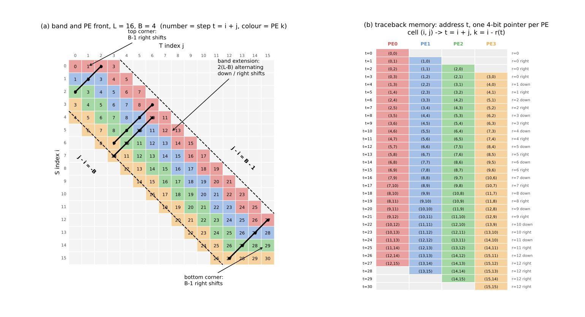
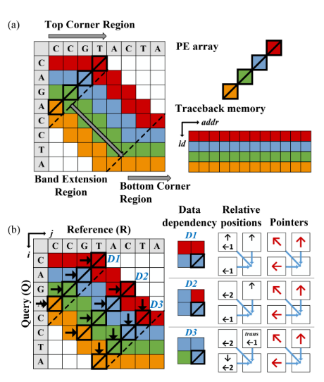
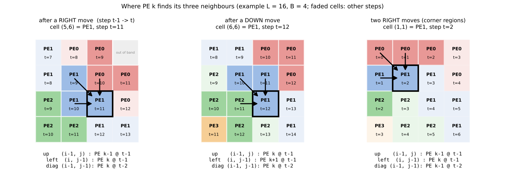
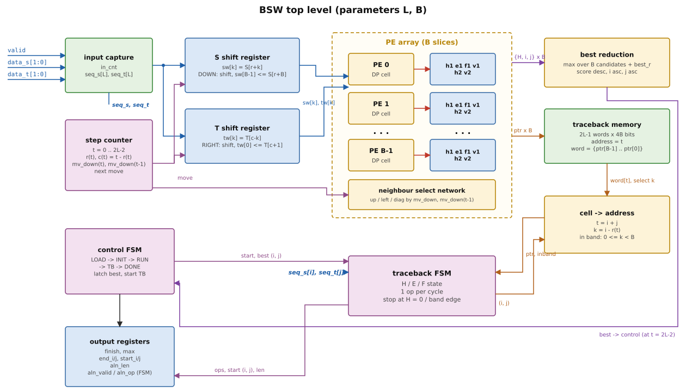
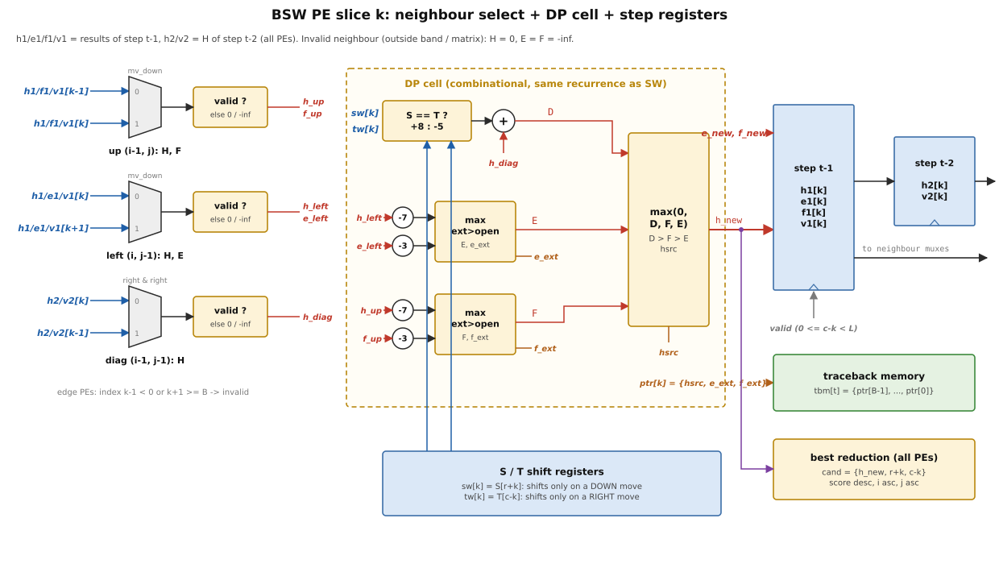
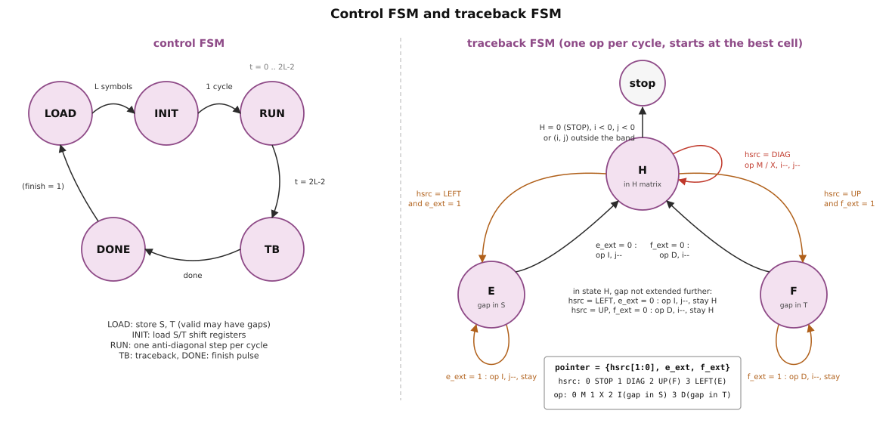
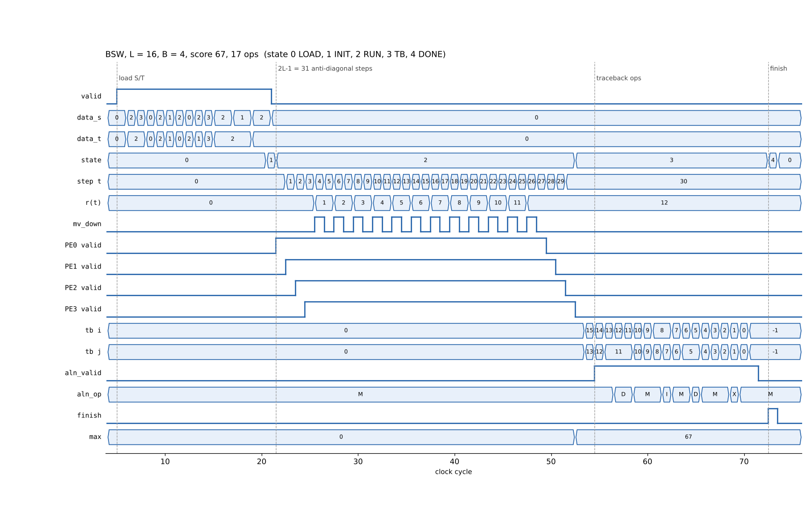
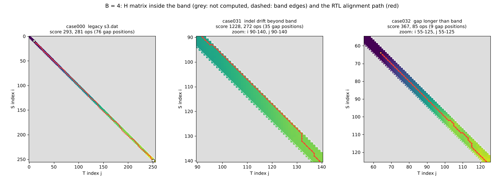
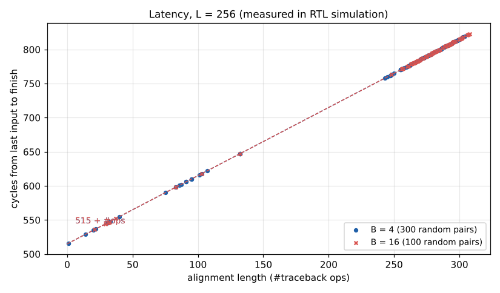

# Banded Smith-Waterman 硬體加速器設計報告

> 依 Liao et al., *Adaptively Banded Smith-Waterman Algorithm for Long Reads and Its Hardware Accelerator* (ASAP 2018) 的 fixed-band 架構實作
> B 個 PE 沿反對角線排列，band 寬度參數化，含硬體 traceback（Verilog RTL）

## 目錄
1. [規格摘要](#1-規格摘要)
2. [演算法](#2-演算法)
3. [硬體架構](#3-硬體架構)
4. [驗證方法與結果](#4-驗證方法與結果)
5. [合成估計](#5-合成估計)
6. [使用方式與檔案結構](#6-使用方式與檔案結構)

---

## 1. 規格摘要

| 項目 | 規格 |
|---|---|
| 功能 | 兩條等長 DNA 序列 S、T 在對角線附近 band 內的區域比對，輸出最高分、起點與終點、完整比對路徑 |
| 參數 | `L` 序列長度（預設 256，不需為 2 的次方）、`B` PE 數 = band 參數（預設 4，1 ≤ B ≤ L） |
| Band | 計算所有滿足 **−B ≤ j − i ≤ B − 1** 的 cell（2B 條對角線，共 2BL − B² 格），每格恰好算一次 |
| 計分 | match +8、mismatch −5、gap open −7、gap extend −3（同 SW repo） |
| 架構 | B 個 PE 排在反對角線上；每個 step 計算一條反對角線上的 B 格，front 依 right / down 移動 |
| 分數位寬 | 13 bit signed（L = 256） |
| Traceback | 每格 4 bit pointer，存在以 step 為位址的 traceback 記憶體（2L−1 words × 4B bit） |
| 延遲 | 輸入完成後 `2L + 3 + 比對長度` 個 cycle 拉起 `finish`（L = 256：515 + ops） |
| 輸入協定 | 在 `valid` 為 1 的 cycle 送 S[k]、T[k]，共 L 筆；**中間可以有空檔** |
| 重置 | 非同步 active-high；`finish` 後自動回到 LOAD，可直接送下一組 |


### 1.1 適用範圍：single-tile accelerator

本設計是 **single-tile** 的加速器：一次只處理一個 tile，也就是長度同為 `L` 的 query `S` 與 reference `T`，且只計算這個 tile 在對角線附近的 band。**`L` 是 tile 大小、`B` 是 band 寬度**，兩者都是編譯時的 parameter，使用者可依需求自行選擇。資源隨參數成長如下：

* traceback 記憶體 = (2L − 1) × 4B bit，與 `L`、`B` 都是**線性**關係（完整 SW 的 tile 則需要 4·L² bit）；
* PE 數 = `B`；分數位寬 = ⌈log2(8L+1)⌉ + 1 bit。

| `L`（tile 大小） | 分數位寬 | B = 4 | B = 16 | 完整 SW tile（4·L²）供對照 |
|---:|---:|---:|---:|---:|
| 64 | 11 bit | 2,032 bit | 8,128 bit | 16,384 bit |
| 128 | 12 bit | 4,080 bit | 16,320 bit | 65,536 bit |
| 256 | 13 bit | 8,176 bit | 32,704 bit | 262,144 bit |
| 512 | 14 bit | 16,368 bit | 65,472 bit | 1,048,576 bit |
| 1024 | 15 bit | 32,752 bit | 131,008 bit | 4,194,304 bit |
| 2048 | 16 bit | 65,520 bit | 262,080 bit | 16,777,216 bit |

* 實際模擬驗證的範圍只有 `L` = 4 … 256；更大的 `L` 由同一組 parameter 推得，尚未驗證。
* `S`、`T` 必須剛好各 `L` 個鹼基（`valid` 之間可以有空檔）；較短的序列需自行補齊，不支援兩者不等長。

實際應用中 S 與 T 通常長得很像，比對結果會集中在主對角線附近，這正是 band 能省下運算與記憶體的原因，也是較長的序列預期沿對角線切成多個 tile、再把各 tile 的結果串接起來的原因。**本專案只實作單一 tile**；tile 與 tile 之間的串接**沒有處理**，包括相鄰 tile 之間邊界狀態（H / E / F）的傳遞、各 tile 最高分的合併，以及 traceback 路徑的接合，都需要在本模組之外完成。

---

## 2. 演算法

### 2.1 遞迴式

與完整 Smith-Waterman 相同的 affine gap 遞迴，只是 band 外的 cell 不計算（視為 H = 0、E = F = −∞）：

```
E(i,j) = max( E(i,j-1) - 3 ,  H(i,j-1) - 7 )                     gap 在 S（INS）
F(i,j) = max( F(i-1,j) - 3 ,  H(i-1,j) - 7 )                     gap 在 T（DEL）
H(i,j) = max( 0 ,  H(i-1,j-1) + s(S[i],T[j]) ,  E(i,j) ,  F(i,j) )      若 -B <= j-i <= B-1
H(i,j) = 0 ,  E = F = -inf                                               否則（band 外與矩陣外）
```

band 只保留主對角線附近的 cell，假設最佳比對不會偏離主對角線太遠。偏移超過 band 的比對無法被找到，這是用計算量和記憶體換來的取捨（4.2 節的 band 邊界測資就是在驗證這一點）。

### 2.2 PE front 的移動（論文中的 fixed band）

B 個 PE 排在一條反對角線上。在第 t 步，front 的位置是 (r, c)，PE k 計算 cell **(i, j) = (r + k, c − k)**，所以 i + j = t。同一步的 B 格沒有資料相依，可以同時計算。

front 每一步移動一格，共 2L − 1 步（t = 0 … 2L−2）：

| 區段 | 移動方式 | 步數 |
|---|---|---|
| top corner | 只往右，PE 依序開始運作 | B − 1 |
| band extension | 下、右交替（先下） | 2(L − B) |
| bottom corner | 只往右，最後停在 (L−1, L−1) | B − 1 |

寫成公式：

```
r(t) = 0                              , t <= B-1
r(t) = min( ceil((t-B+1)/2) , L-B )   , 其他
c(t) = t - r(t)
PE k 有效  <=>  0 <= c(t) - k <= L-1
```

每條反對角線 i + j = t 剛好被走過一次。往右移之後，front 覆蓋的 j − i 是 {B−1, B−3, …, −B+1}；往下移之後是 {B−2, …, −B}。兩者合起來正好是 −B ≤ j − i ≤ B − 1。



（a）L = 16、B = 4 的 band：顏色代表負責計算的 PE，數字代表計算時的 step t，黑線是幾個 step 的 front 位置。（b）traceback 記憶體的內容：位址 t 存放 B 個 pointer。

論文中的架構示意（取自 Liao et al. 2018，作為參考）：



### 2.3 鄰居相依

由 front 的移動方式可以推得，PE k 需要的三個鄰居一定在前一步或前兩步、而且在自己或相鄰的 PE 上：



| 需要的值 | 這一步是往右移 | 這一步是往下移 |
|---|---|---|
| 上 (i−1, j)：H、F | PE k−1 @ t−1 | PE k @ t−1 |
| 左 (i, j−1)：H、E | PE k @ t−1 | PE k+1 @ t−1 |
| 左上 (i−1, j−1)：H | 前兩步都往右：PE k−1 @ t−2；其他情況：PE k @ t−2 | |

鄰居 PE 的編號超出 0…B−1，或該 PE 在那一步無效時，代表那一格在 band 或矩陣之外，就用 H = 0、E = F = −∞。

### 2.4 Traceback

pointer 格式、三狀態（H / E / F）回溯與同分規則都與 SW repo 相同：

* **pointer**：`{hsrc[1:0], e_ext, f_ext}`，其中 hsrc：0 STOP、1 DIAG、2 UP、3 LEFT。
* **最佳格**：分數最高；同分取 i 最小，再同分取 j 最小。
* **H 的來源**：優先序 DIAG > UP > LEFT；只有在延伸嚴格較佳時才算 gap 延伸。

banded 版本的不同之處在於 pointer 的定址：cell (i, j) 存在 **位址 t = i + j、欄位 k = i − r(t)**。因為 band 外的 H 被當成 0，最佳路徑不可能走出 band；traceback FSM 仍保留一個 band 檢查作為防護。

### 2.5 Golden model

`BSW.py` 是逐位元對應硬體的模型（`--band B`；`--band 0` 為完整 SW）。它的驗證方式（`tools/validate_model.py`）：

* **完整 SW 模式**：分數與 Biopython `PairwiseAligner` 比對（3,000 組）。
* **banded 模式**：分數與另一份獨立寫的 banded 實作比對（6,855 次，B = 1、2、3、4、L/3、L）。
* **自我檢查**：每個 traceback 都會重新計分，必須等於回報的最高分；B = L 時結果必須等於完整 SW。

---

## 3. 硬體架構

### 3.1 頂層



| 方塊 | 功能 |
|---|---|
| input capture | 把 S、T 存進 `seq_s[L]`、`seq_t[L]`；只在 `valid` 時寫入，所以輸入中間可以有空檔 |
| step counter | `t_r` 與 `r(t)`、`c(t)`；產生這一步與前一步的移動方向 `mv_down`、`mv_down(t−1)`，以及下一步的移動方向 |
| S / T shift register | `sw[k] = S[r+k]`、`tw[k] = T[c−k]`；往下移時只移 S（`sw[B−1] ← S[r+B]`），往右移時只移 T（`tw[0] ← T[c+1]`），和論文的 Q / R shift register 相同 |
| PE array | B 個 DP cell + 鄰居選擇網路 + 兩級 step 暫存器 |
| best reduction | 每一步把 B 個候選 `{H, i, j}` 與 `best_r` 合併 |
| traceback memory | 位址 t，每個 word 存 B 個 4 bit pointer |
| cell → address | 由 (i, j) 算出 t = i + j、r(t)、k = i − r(t)，以及是否在 band 內 |
| traceback FSM | 每個 cycle 輸出一個比對運算 |
| control FSM | LOAD → INIT → RUN → TB → DONE |

### 3.2 PE slice



* **鄰居選擇**：三組 MUX 依 2.3 節的表格選出 up、left、diag，無效的鄰居換成 0 / −∞。
* **DP cell**：純組合邏輯，計算 E、F、D 與 `max(0, D, F, E)`，並輸出 pointer。
* **step 暫存器**：`h1/e1/f1/v1` 存第 t−1 步的結果，`h2/v2` 存第 t−2 步的 H。所有 PE 只需要保留這兩步，與 L 無關。

### 3.3 控制



| 狀態 | cycle 數 | 動作 |
|---|---|---|
| LOAD | L（加上輸入空檔） | 接收序列 |
| INIT | 1 | 載入 shift register：`sw[k] = S[k]`、`tw[0] = T[0]`，並清除 step 暫存器 |
| RUN | 2L − 1 | 每個 cycle 一步；最後一步時把最佳格鎖存為 `max`、`end_i/j`，並啟動 traceback |
| TB | 比對長度 + 2 | 每個 cycle 輸出一個運算 |
| DONE | 1 | `finish` 脈衝，輸出 `start_i/j` 與 `aln_len` |

PE 使用率 = band 格數 / (B · 步數) = (2BL − B²) / (B(2L − 1))。L = 256、B = 4 時為 2032 / 2044 = 99.4%。

### 3.4 介面

| port | 方向 | 寬度 | 說明 |
|---|---|---|---|
| `clk`, `reset` | in | 1 | 時脈；非同步 active-high 重置 |
| `valid`, `data_s`, `data_t` | in | 1 / 2 / 2 | 第 k 次 `valid` 送 S[k]、T[k] |
| `aln_valid`, `aln_op` | out | 1 / 2 | 0 MATCH、1 MISMATCH、2 INS、3 DEL，由比對終點往起點輸出 |
| `finish` | out | 1 | 完成脈衝 |
| `max` | out | 13 | 最高分 |
| `end_i/j`, `start_i/j` | out | 8 | 比對的最後一對與第一對鹼基位置 |
| `aln_len` | out | 10 | 運算個數 |

---

## 4. 驗證方法與結果

### 4.1 驗證流程

與 SW repo 相同：`gen_pattern.py --band B` 產生測資與 golden，`tb_BSW.v` 背靠背跑完所有測資，比對 score、end、start、長度以及每一個運算，最後做 reset 恢復測試。`run_regression.py` 負責跑完整的配置矩陣。

### 4.2 測資

固定的 regression set（`testbench/pattern`，B = 4，33 組）包含：

* **典型配對**：原始 s3 / t3、完全相同、完全不配、隨機、5% / 20% 突變、長 gap、低複雜度序列等。
* **directed 測資**：S 只用 {A, C}、T 只用 {G, T} 當背景，再把 motif 種在指定位置：
  * motif 放在角落或中間
  * 同分
  * 長 INS / DEL
  * 混合 indel
  * 週期序列等
* **band 專用測資**：
  * motif 的 j − i 剛好是 B − 1 與 −B（band 內，必須完整找到）
  * motif 的 j − i 是 B 與 −B − 1（剛好在 band 外，不能找到）
  * 每 L/8 插入一個鹼基，讓路徑逐漸漂出 band
  * gap 長度大於 B

| case | 測資 | 分數 | 終點 (i,j) | 起點 (i,j) | 運算數 | B = 4 | B = 4, valid gaps |
|---|---|---|---|---|---|---|---|
| 000 | sample s3.dat | 293 | (252,251) | (9,10) | 281 | ✓ | ✓ |
| 001 | identical | 2048 | (255,255) | (0,0) | 256 | ✓ | ✓ |
| 002 | all mismatch | 0 | (0,0) | (1,1) | 0 | ✓ | ✓ |
| 003 | unrelated random | 372 | (251,254) | (0,0) | 290 | ✓ | ✓ |
| 004 | 5% subst + small indels | 1646 | (253,254) | (1,1) | 259 | ✓ | ✓ |
| 005 | long gaps | 1399 | (253,255) | (0,0) | 274 | ✓ | ✓ |
| 006 | local region | 329 | (254,254) | (12,9) | 281 | ✓ | ✓ |
| 007 | 20% subst + indels | 475 | (251,252) | (0,0) | 292 | ✓ | ✓ |
| 008 | shifted copy | 2024 | (252,255) | (0,3) | 253 | ✓ | ✓ |
| 009 | low complexity | 1430 | (254,255) | (0,0) | 274 | ✓ | ✓ |
| 010 | motif in the middle | 256 | (95,98) | (64,67) | 32 | ✓ | ✓ |
| 011 | motif at the start (0,0) | 256 | (31,31) | (0,0) | 32 | ✓ | ✓ |
| 012 | motif at the end (L-1,L-1) | 256 | (255,255) | (224,224) | 32 | ✓ | ✓ |
| 013 | motif S start / T end | 47 | (31,27) | (8,11) | 24 | ✓ | ✓ |
| 014 | motif S end / T start | 50 | (31,30) | (7,4) | 29 | ✓ | ✓ |
| 015 | single matching base | 8 | (85,84) | (85,84) | 1 | ✓ | ✓ |
| 016 | tie: two equal hits in S | 256 | (63,63) | (32,32) | 32 | ✓ | ✓ |
| 017 | tie: two equal hits in T | 256 | (63,63) | (32,32) | 32 | ✓ | ✓ |
| 018 | tie: 2x2 equal hits | 256 | (41,41) | (10,10) | 32 | ✓ | ✓ |
| 019 | long INS (gap in S) | 328 | (104,104) | (64,64) | 41 | ✓ | ✓ |
| 020 | long DEL (gap in T) | 416 | (163,166) | (64,64) | 109 | ✓ | ✓ |
| 021 | mixed short indels | 944 | (159,159) | (32,32) | 132 | ✓ | ✓ |
| 022 | every 3rd base mismatch | 123 | (95,95) | (63,64) | 34 | ✓ | ✓ |
| 023 | bridge over 3 mismatches | 625 | (146,146) | (64,64) | 83 | ✓ | ✓ |
| 024 | all same base | 2048 | (255,255) | (0,0) | 256 | ✓ | ✓ |
| 025 | periodic AC vs CA | 2040 | (254,255) | (0,1) | 255 | ✓ | ✓ |
| 026 | identical core, mutated ends | 1938 | (250,249) | (4,2) | 249 | ✓ | ✓ |
| 027 | band edge inside, j-i = B-1 | 256 | (95,98) | (64,67) | 32 | ✓ | ✓ |
| 028 | band edge inside, j-i = -B | 256 | (99,95) | (68,64) | 32 | ✓ | ✓ |
| 029 | band edge outside, j-i = B | 54 | (93,96) | (66,66) | 34 | ✓ | ✓ |
| 030 | band edge outside, j-i = -B-1 | 57 | (100,97) | (73,74) | 32 | ✓ | ✓ |
| 031 | indel drift beyond band | 1228 | (255,252) | (0,0) | 272 | ✓ | ✓ |
| 032 | gap longer than band | 367 | (145,142) | (64,64) | 85 | ✓ | ✓ |

band 邊界的結果符合預期：offset 在 band 內的兩組都得到完整的 256 分（32 個 match），只差一格落在 band 外的兩組只得到 54 / 57 分。

### 4.3 Regression 結果

| 配置 | L | B | 測資數 | 通過 | reset 恢復 | 比對的 traceback 運算數 | 延遲 − 比對長度（cycle） |
|---|---|---|---|---|---|---|---|
| regression set | 256 | 4 | 33 | 33 | pass | 4352 | 515 |
| regression set | 256 | 1 | 33 | 33 | pass | 2651 | 515 |
| regression set | 256 | 2 | 33 | 33 | pass | 4046 | 515 |
| regression set | 256 | 3 | 33 | 33 | pass | 4228 | 515 |
| regression set | 256 | 8 | 33 | 33 | pass | 4342 | 515 |
| regression set | 256 | 16 | 33 | 33 | pass | 4423 | 515 |
| regression set | 256 | 32 | 33 | 33 | pass | 4369 | 515 |
| regression set | 256 | 64 | 33 | 33 | pass | 4270 | 515 |
| regression set | 256 | 256 | 33 | 33 | pass | 4234 | 515 |
| regression set（輸入隨機空檔） | 256 | 4 | 33 | 33 | pass | 4352 | 515 |
| 隨機 | 256 | 4 | 300 | 300 | pass | 72348 | 515 |
| 隨機 | 256 | 16 | 100 | 100 | pass | 24133 | 515 |
| 隨機 | 4 | 1 | 150 | 150 | pass | 423 | 11 |
| 隨機 | 4 | 2 | 150 | 150 | pass | 432 | 11 |
| 隨機 | 4 | 4 | 150 | 150 | pass | 453 | 11 |
| 隨機 | 8 | 1 | 150 | 150 | pass | 773 | 19 |
| 隨機 | 8 | 2 | 150 | 150 | pass | 839 | 19 |
| 隨機 | 8 | 3 | 150 | 150 | pass | 916 | 19 |
| 隨機 | 8 | 8 | 150 | 150 | pass | 906 | 19 |
| 隨機 | 16 | 1 | 150 | 150 | pass | 1394 | 35 |
| 隨機 | 16 | 2 | 150 | 150 | pass | 1751 | 35 |
| 隨機 | 16 | 4 | 150 | 150 | pass | 1833 | 35 |
| 隨機 | 16 | 5 | 150 | 150 | pass | 1814 | 35 |
| 隨機 | 16 | 16 | 150 | 150 | pass | 1860 | 35 |
| 隨機 | 20 | 3 | 150 | 150 | pass | 2111 | 43 |
| 隨機 | 20 | 7 | 150 | 150 | pass | 2386 | 43 |
| 隨機 | 20 | 20 | 150 | 150 | pass | 2413 | 43 |
| 隨機 | 33 | 1 | 150 | 150 | pass | 2534 | 69 |
| 隨機 | 33 | 4 | 150 | 150 | pass | 4253 | 69 |
| 隨機 | 33 | 11 | 150 | 150 | pass | 4140 | 69 |
| 隨機 | 64 | 2 | 150 | 150 | pass | 6745 | 131 |
| 隨機 | 64 | 8 | 150 | 150 | pass | 8839 | 131 |
| 隨機 | 64 | 13 | 150 | 150 | pass | 8200 | 131 |
| 隨機 | 64 | 64 | 150 | 150 | pass | 8253 | 131 |
| 隨機 | 100 | 4 | 150 | 150 | pass | 12042 | 203 |
| 隨機 | 100 | 9 | 150 | 150 | pass | 13388 | 203 |
| 隨機 | 100 | 50 | 150 | 150 | pass | 12918 | 203 |
| 隨機 | 128 | 4 | 150 | 150 | pass | 16381 | 259 |
| 隨機 | 128 | 16 | 150 | 150 | pass | 17680 | 259 |
| **總計** | | | **4780** | **4780** | | **273425** | |

**總計：39 種配置、4,780 組測資全部通過，硬體輸出的 273,425 個 traceback 運算全部與 golden 一致**

「random valid gaps」配置在輸入之間隨機插入空檔，結果與連續輸入相同。延遲欄位是「最後一筆輸入到 `finish` 的 cycle 數 − 比對長度」，所有配置都是 2L + 3。

### 4.4 Testbench 的偵錯能力（mutation test）

| 植入的錯誤 | 失敗數（B = 4） |
|---|---|
| diag 鄰居固定取 PE k | 8 / 34 |
| 往下移之後，left 的 H 取 PE k（應為 k+1） | 13 / 34 |
| 排程改為先右後下 | 14 / 34 |
| gap 延伸在同分時也算延伸 | 5 / 34 |
| 最佳格同分時改取較大的 i / j | 5 / 34 |
| traceback 忽略 `e_ext` | 11 / 34 |
| traceback 移除 band 檢查 | 0 / 34（等價，見下） |

（34 = 33 組測資 + reset 恢復後的重跑）

唯一沒被抓到的是 traceback 的 band 檢查：band 外的 H 視為 0，回溯路徑本來就不會離開 band，所以這個檢查只是防禦性的，移除後行為完全相同。

### 4.5 波形

L = 16、B = 4 的一次完整比對（分數 67、17 個運算，含 2 格 DEL 與 1 格 INS）：



* **RUN 階段**：`step t` 從 0 數到 30（2L − 1 步）。`r(t)` 在 t ≤ 3 時固定為 0（top corner），之後每兩步加 1，`mv_down` 呈現下、右交替，最後停在 12 = L − B（bottom corner）。
* **PE 啟用順序**：PE k 在 t = k 時開始有效（top corner），在 t = 2L − 1 − B + k 時結束（bottom corner）。

### 4.6 比對路徑



* **case000**：路徑整段都落在 band 內。
* **case031**（每 32 個鹼基插入一個）：路徑逐漸往 band 邊緣靠，最後貼著邊界走。
* **case032**（真實的 gap 長度為 B + 2 = 6，超出 band）：硬體輸出的路徑裡沒有長度 6 的 gap，而是由幾段 1–2 格的 indel 在 band 內組成；這就是 banded 方法的限制。

圖中紅線是 **RTL 實際輸出** 的運算序列。

### 4.7 延遲



延遲與 B 無關，只取決於 L 與比對長度：2L + 3 + ops。

---

## 5. 合成估計

使用 Yosys 0.33 做 generic gate 合成（L = 256，記憶體保留為 `$mem`）。這只是規模估計，不是特定製程的面積或時序結果。

| 配置（L = 256） | generic 邏輯閘 | flip-flop | 記憶體 bit（序列 + traceback） |
|---|---|---|---|
| B = 4 | 3,755 | 390 | 1,024 + 8,176 = 9,200 |
| B = 8 | 6,948 | 622 | 1,024 + 16,352 = 17,376 |
| B = 16 | 13,249 | 1,086 | 1,024 + 32,704 = 33,728 |

觀察：

* **邏輯閘數約與 B 成正比**：每個 PE slice 約 800 個 generic gate。
* **traceback 記憶體只有 (2L−1)·4B bit**：B = 4 時為 8,176 bit，約是完整 SW 的 pointer 記憶體（4L² = 262,144 bit）的 1/32。這也是 banded 方法在硬體上的主要好處。
* **組合邏輯深度（B = 4）為 141 級 generic gate**：較長的路徑來自 best reduction（B 個候選依序比較）以及 traceback 定址中的 r(t) 計算。要提高時脈的話，可以把 best reduction 改成比較樹，或是加一級 pipeline。

---

## 6. 使用方式與檔案結構

```
BSW.py                   golden model（python3 BSW.py --band 4 --s a.dat --t b.dat）
gen_pattern.py           產生測資與 golden（--band, --length, --random, --pairs）
verilog/BSW.v            RTL：BSW（top）、BSW_PE、BSW_traceback
verilog/BSW_syn.sdc      Design Compiler 合成 script
testbench/tb_BSW.v       testbench（BAND、SEQ_L、PAT_DIR、RAND_GAP、VCD、FSDB、SDF）
testbench/pattern/       regression set（B = 4，33 組）與 cases.txt
testbench/run_iverilog.sh      快速測試
testbench/run_regression.py    完整 regression，輸出 regression_summary.md / .csv
tools/validate_model.py        golden model 交叉驗證
tools/mutation_test.py         testbench 偵錯能力測試
report/                        本報告與圖
```

```
cd testbench
vcs tb_BSW.v +define+RTL -full64 -R +v2k                       # B = 4
python3 ../gen_pattern.py --band 8 --out pattern_b8              # 其他 band
vcs tb_BSW.v +define+RTL+BAND=8+PAT_DIR=\"pattern_b8/\" -full64 -R +v2k
python3 run_regression.py                                        # 完整 regression
```
